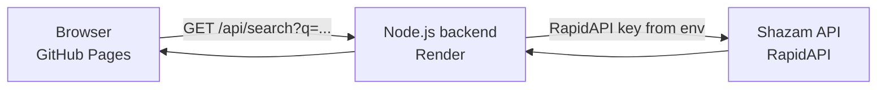

<div align="center">


# Spotify Clone

**Search any song or artist, browse the artwork, and play a preview, all in the browser.**


[**Live demo**](https://hasankoparan.github.io/spotify-clone/) · [Report a bug](https://github.com/HasanKoparan/spotify-clone/issues)

</div>

<!-- Add a screenshot: save it as docs/screenshot.png and uncomment the line below -->
<!--  -->

## Features

- Search by song title or artist (try **Tarkan** or **Sezen Aksu**)
- Album artwork, track title and artist on every card
- Built-in player with play/pause, progress bar and volume
- Opening screen with a curated list of NEFFEX tracks
- Responsive dark UI styled with SCSS (mixins, variables, partials)
- API key stays on the server, never in the browser

> **Heads up:** the backend runs on a free Render instance. If nobody used it for a while, the first search can take 30-60 seconds while the server wakes up.

## How it works



1. The browser sends the search term to the Node.js endpoint `GET /api/search?q=...`.
2. The backend calls the Shazam API through RapidAPI and returns a list of tracks.
3. The frontend renders title, artist and artwork, and plays the preview URL when one is available.
4. The RapidAPI key is read by the server from an environment variable, so it is never exposed to the client.

## Tech stack

| Layer | Stack | Hosting |
| --- | --- | --- |
| Frontend | HTML, SCSS, vanilla JavaScript | GitHub Pages |
| Backend | Node.js and its built-in `http` module (no frameworks) | Render |
| Music data | Shazam API via RapidAPI | RapidAPI |

## Run locally

**Requirements:** Node.js 24 and a RapidAPI account subscribed to the Shazam API.

**1. Clone the repository**

```bash
git clone https://github.com/HasanKoparan/spotify-clone.git
cd spotify-clone
```

**2. Create the env file** (outside the project, so it can never be committed)

```bash
echo "RAPIDAPI_KEY=your_key_here" > ~/.spotify-clone.env
```

**3. Start the backend**

```bash
node --env-file="$HOME/.spotify-clone.env" js/server.mjs
```

**4. Start the frontend**

Open `index.html` with the VS Code **Live Server** extension at `http://127.0.0.1:5500/index.html`.
The frontend automatically talks to your local backend when served from `127.0.0.1`.

## Project structure

```text
spotify-clone/
├── index.html
├── logo.png
├── js/
│   ├── api.js       # talks to the backend
│   ├── ui.js        # renders cards and the player
│   ├── main.js      # app entry point and events
│   └── server.mjs   # Node.js backend (RapidAPI proxy)
└── styles/
    ├── styles.scss  # imports all partials
    └── _aside, _main, _player, _mixin, _variables
```

## Roadmap

- [ ] Loading and error states for slow or failed searches
- [ ] Debounced search-as-you-type
- [ ] Working sidebar pages (Library, Playlists, Liked Songs)
- [ ] Response caching on the backend to save RapidAPI quota

## What I learned

How to connect a vanilla JavaScript frontend to a deployed Node.js backend, keep secrets out of client code, handle CORS, and deploy a split frontend/backend app.

## Disclaimer

This is a learning project built as part of the Udemig software development program. Spotify and Shazam are third-party brands and are not affiliated with this project.

## Author

**Hasan Koparan**
[LinkedIn](https://www.linkedin.com/) · [More projects on GitHub](https://github.com/HasanKoparan)

<sub>README polished with Claude (Anthropic).</sub>
